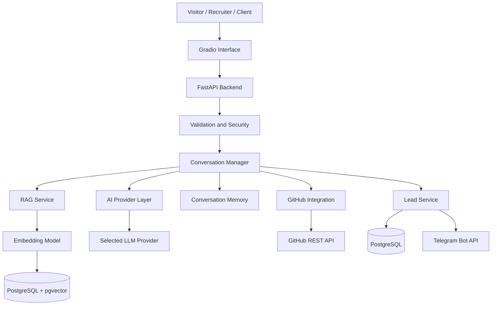

# System Architecture — Vivek AI Portfolio Twin

## 1. Architecture Overview

The application will use a modular architecture that separates the user interface, backend logic, AI processing, knowledge retrieval, integrations, and data storage.

The initial interface will use Gradio. FastAPI will provide an independent backend so that a custom frontend can be introduced later without rebuilding the core application.

## 2. High-Level Architecture

This is the proposed architecture, not an implemented system.

## 3. Core Components

### 3.1 User Interface — Gradio

Responsibilities:

- Display the portfolio assistant.
- Accept visitor messages.
- Display AI responses.
- Present project and GitHub information.
- Provide a professional contact experience.

The UI will communicate with the backend rather than containing business logic.

### 3.2 Backend API — FastAPI

Responsibilities:

- Receive chat requests.
- Validate incoming data.
- Manage API endpoints.
- Coordinate application services.
- Handle errors and responses.
- Protect internal operations.

Planned endpoints:

| Method | Endpoint | Purpose |
|---|---|---|
| GET | `/health` | Application health check |
| POST | `/chat` | Process chat messages |
| POST | `/leads` | Submit validated lead information |
| GET | `/projects` | Retrieve project information |

Endpoints may evolve during implementation.

### 3.3 AI Provider Layer

This layer isolates the application from a specific LLM provider.

Responsibilities:

- Send prompts and context to the selected model.
- Receive generated responses.
- Handle provider errors.
- Manage generation parameters.
- Support future provider switching.

A common interface will allow different provider implementations without changing the conversation manager.

The final provider will be selected after evaluating quality, cost, latency, tool-calling reliability, and privacy.

### 3.4 Conversation Manager

This is the central orchestration component.

Responsibilities:

1. Receive a validated visitor message.
2. Retrieve relevant conversation history.
3. Request relevant professional knowledge through RAG.
4. Construct the model context.
5. Call the AI provider.
6. Process the generated response.
7. Return the answer to the visitor.

The conversation manager coordinates services but should not directly own database or external integration details.

### 3.5 RAG Service

Retrieval-Augmented Generation allows the assistant to answer questions using verified information about Vivek.

Planned workflow:

1. Load profile, skills, project, and experience documents.
2. Extract and clean their text.
3. Divide text into meaningful chunks.
4. Generate vector embeddings.
5. Store embeddings and metadata in PostgreSQL with pgvector.
6. Convert incoming questions into embeddings.
7. Retrieve relevant chunks.
8. Provide retrieved context to the LLM.
9. Generate an answer grounded in the retrieved information.

Retrieved sources will be used to support factual claims and citations.

### 3.6 Conversation Memory

Memory will maintain context across a visitor's conversation.

Planned approach:

- Recent message history.
- Rolling conversation summaries.
- Persistent visitor isolation.
- Controlled context limits.

Each visitor's conversation must remain separate. Information from one visitor must never appear in another visitor's session.

### 3.7 GitHub Integration

The GitHub integration will use the GitHub REST API.

Responsibilities:

- Retrieve public repository information.
- Filter out forked repositories where appropriate.
- Sort repositories by recent activity.
- Present relevant project information.
- Cache results to reduce unnecessary API calls.

The assistant must not claim to have inspected source code unless it actually retrieved and examined it.

### 3.8 Lead Management

The lead service will handle professional contact requests.

Planned workflow:

1. Identify genuine professional interest.
2. Request necessary contact details and consent.
3. Validate the submitted information.
4. Store the lead in the database.
5. Send a Telegram notification.
6. Confirm successful submission to the visitor.

The LLM may identify lead intent, but Python backend logic will control validation, persistence, and notifications.

A generated AI response alone must never be treated as proof that a lead was successfully captured.

## 4. Data Storage

PostgreSQL is the planned primary database.

It will eventually store:

- Lead information.
- Visitor/session identifiers.
- Conversation summaries where persistence is required.
- Knowledge chunks and metadata.
- Vector embeddings through pgvector.

Sensitive information will be collected only when necessary and handled carefully.

## 5. External Services

| Service | Purpose |
|---|---|
| LLM provider | AI response generation |
| GitHub REST API | Public repository information |
| Telegram Bot API | Private lead notifications |
| PostgreSQL hosting | Persistent application data |
| Hugging Face Spaces | Initial application hosting |

External services will be integrated through dedicated modules.

## 6. Security and Reliability

Planned safeguards:

- Environment variables for credentials.
- Input validation using Pydantic.
- Rate limiting.
- Visitor/session isolation.
- Error handling and logging.
- Duplicate lead detection.
- Database write verification.
- Safe handling of external API failures.
- No exposure of private credentials or internal data.

## 7. Architectural Principles

1. Separation of concerns.
2. Modular and replaceable components.
3. Provider-independent AI integration.
4. Backend-controlled external actions.
5. Source-grounded AI responses.
6. Persistent and isolated data storage.
7. Testability and observability.
8. Incremental implementation instead of premature complexity.

## 8. Future Extensions

The architecture should allow future additions such as:

- React frontend.
- Voice interaction.
- Advanced agent workflows.
- Job opportunity discovery.
- Freelance opportunity assistance.
- Additional AI providers.
- More advanced evaluation and monitoring.

These extensions are outside the initial MVP.

## 9. Current Implementation Status

**Status:** Architecture proposed and documented.

No application components have been implemented or tested yet.

The architecture will be updated as implementation decisions are validated.
